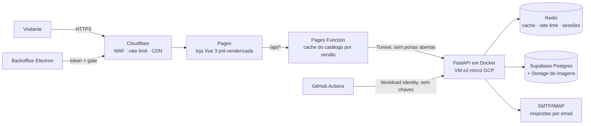

# Diomika — plataforma B2B de catálogo e orçamentos

> **Espelho público** do repositório privado de produção: o código é o mesmo; identificadores de infraestrutura foram substituídos, o histórico foi condensado e os workflows de deploy estão em [`ops/workflows/`](ops/workflows) só para leitura. Segredos nunca estiveram no código (GitHub Secrets e `.env` do servidor).

[](https://github.com/tomascms/diomika-platform/actions/workflows/ci.yml) [](https://github.com/tomascms/diomika-platform/actions/workflows/security-scan.yml)

**Em produção:** [www.diomika.com](https://www.diomika.com) · loja + API + backoffice desktop, construídos
e operados de ponta a ponta por uma pessoa, com **0 € de infraestrutura**.

> **EN —** Production B2B catalogue and quote-request platform for a Portuguese home-textiles
> supplier. Vue 3 storefront on Cloudflare Pages (edge-cached catalogue, prerendered SEO pages),
> FastAPI backend in Docker on a free GCP e2-micro behind Cloudflare Tunnel, Supabase Postgres,
> and an auto-updating Electron backoffice. Built, secured, measured and run solo at zero hosting
> cost. Docs are in Portuguese; see *Destaques* below for the engineering highlights.

## O problema
Um fornecedor de têxteis para o lar vende só a lojas (pedido mínimo 500 € + IVA, sem preços
públicos). Precisava de: um catálogo online com modelos em várias cores e medidas (cada variante com EAN),
pedidos de orçamento sem conta de cliente, e uma ferramenta interna para gerir catálogo, mensagens
e pedidos — sem custos mensais de alojamento.

## Arquitectura


| Peça | Pasta | Tecnologia | Onde corre |
|---|---|---|---|
| Loja | [`frontend-web/`](frontend-web) | Vue 3, Vite, Pages Functions | Cloudflare Pages |
| API | [`backend-api/`](backend-api) | Python 3.12, FastAPI, Redis | Docker na GCP e2-micro (Always Free), Cloudflare Tunnel |
| Base de dados | [`db/`](db) | PostgreSQL (Supabase), RLS, migrações versionadas | Supabase Free (Irlanda) |
| Backoffice | [`backoffice-desktop/`](backoffice-desktop) | Electron, Vue 3, auto-update | PCs do cliente |
| Operação | [`deploy/`](deploy), [`.github/`](.github/workflows) | Bash, Python, GitHub Actions | VM + CI |

## Destaques (medidos em produção)

**Desempenho**
- LCP no telemóvel: **0,64 s** na página inicial e **1,0–1,7 s** numa página de produto nunca
  visitada (era 3,9 s) — *preload* da imagem principal no HTML pré-renderizado + detalhes
  pré-aquecidos em Redis no arranque e depois de cada alteração.
- CLS **0,000** em início, categoria e produto (era 0,9 e 0,15).
- Imagem da página inicial de **435 KB → 22 KB**: miniaturas WebP 480/960 px geradas no upload
  e `srcset` que escolhe pelo ecrã.
- Catálogo em cache no edge com chave por versão (invalidação imediata) e *stale-if-error*: se a
  API cair, a loja continua a mostrar o catálogo até 7 dias.
- TTFB p95 **< 200 ms** através da Cloudflare.

**Segurança**
- VM sem portas abertas: API exposta só por Cloudflare Tunnel; SSH só por IAP.
- Deploy do GitHub para a GCP por **Workload Identity Federation** (sem chaves de serviço).
- CSP estrita sem `unsafe-inline`/`unsafe-eval`, HSTS preload, COOP/CORP — verificadas no CI
  ([`verify_csp.py`](deploy/verify_csp.py)) depois de um incidente real em que a CSP partiu os formulários.
- Turnstile + rate limiting em três camadas (Cloudflare, Redis por IP/utilizador, concorrência do uvicorn).
- Sessões do backoffice com expiração absoluta e por inactividade, revogáveis, uma por utilizador.
- RLS na BD, guarda SSRF nas saídas HTTP, verificação de que nenhum segredo vai no bundle,
  gitleaks/Trivy/Bandit no CI, logs com segredos e emails mascarados.

**Fiabilidade e operação**
- Deploy da API com **recuo automático** para a imagem anterior se `/health/live` falhar.
- Backup diário da BD (incluindo utilizadores do backoffice) com script de **teste de restauro**
  que compara contagens com produção; idempotência nos formulários
  (`Idempotency-Key`) e *outbox* para emails que falham.
- Logs JSON estruturados com `request_id`, Sentry, `/metrics` Prometheus protegido, UptimeRobot.
- Auditoria de requisitos não funcionais com correcções e medições:
  [`docs/auditoria-rnf-2026-10-22.md`](docs/auditoria-rnf-2026-10-22.md) e
  [`docs/conformidade-rnf.md`](docs/conformidade-rnf.md).

**Qualidade**
- 252 testes de backend (isolados: nunca tocam em produção), cobertura com mínimo no CI;
  testes de regressão para cada defeito corrigido (ex.: o event loop não pode bloquear durante
  um envio de formulário).
- Esquema de catálogo unificado e orientado a dados: uma família de produto nova é **uma entrada
  num dicionário** ([`docs/adicionar-familia.md`](docs/adicionar-familia.md)).

## O que este projecto demonstra
| Área | Onde ver |
|---|---|
| **Backend e APIs** — FastAPI assíncrono, RBAC, sessões revogáveis, idempotência, sagas/outbox | [`backend-api/`](backend-api), [`core/session_tokens.py`](backend-api/core/session_tokens.py), [`core/saga/`](backend-api/core/saga) |
| **Frontend e performance web** — Vue 3, pré-renderização SEO, Core Web Vitals medidos e corrigidos | [`frontend-web/`](frontend-web), [`scripts/prerender-seo.mjs`](frontend-web/scripts/prerender-seo.mjs), [`SoftImage.vue`](frontend-web/src/components/SoftImage.vue) |
| **Edge computing** — cache por versão, *stale-if-error*, CSP no edge | [`functions/api/[[path]].js`](frontend-web/functions/api/%5B%5Bpath%5D%5D.js), [`functions/_middleware.js`](frontend-web/functions/_middleware.js) |
| **Aplicação desktop** — Electron com auto-update, proxy local, distribuição Windows/macOS/Linux | [`backoffice-desktop/`](backoffice-desktop), [`electron/updater.cjs`](backoffice-desktop/electron/updater.cjs) |
| **Cloud e infraestrutura** — GCP, Docker Compose, Cloudflare Tunnel/WAF/Pages, IAP, Workload Identity | [`deploy/`](deploy), [`docs/gcp-identidade-deploy.md`](docs/gcp-identidade-deploy.md) |
| **Segurança aplicacional** — CSP, rate limiting em camadas, SSRF guard, RLS, redacção de logs, verificações no CI | [`deploy/verify_*.py`](deploy/README.md#verificar-ci-e-pós-deploy), [`core/ssrf_guard.py`](backend-api/core/ssrf_guard.py) |
| **Dados** — modelo de catálogo unificado orientado a esquema, migrações versionadas, backups e restauro | [`db/`](db), [`models/catalog_attributes.py`](backend-api/models/catalog_attributes.py), [`deploy/vm/`](deploy/vm) |
| **SRE / operação** — deploy com recuo automático, métricas Prometheus, logs estruturados, runbook | [`deploy/vm/remote_deploy.sh`](deploy/vm/remote_deploy.sh), [`core/metrics.py`](backend-api/core/metrics.py), [`docs/runbook.md`](docs/runbook.md) |
| **Engenharia de qualidade** — auditoria de requisitos não funcionais com medições e correcções | [`docs/auditoria-rnf-2026-10-22.md`](docs/auditoria-rnf-2026-10-22.md), [`docs/conformidade-rnf.md`](docs/conformidade-rnf.md) |
| **Produto e cliente** — documentação para o utilizador final | [`docs/guia-cliente.md`](docs/guia-cliente.md) |

## Decisões de engenharia
| Decisão | Porquê | Custo aceite |
|---|---|---|
| VM gratuita + Tunnel em vez de PaaS | 0 €/mês; sem IP público a atacar | 1 só instância (sem alta disponibilidade) |
| Cache no edge com versão do catálogo | Visitantes servidos perto deles; a API nos EUA deixa de pesar | Pedido extra de versão a cada 5 s por PoP |
| Miniaturas geradas no upload | Transformação de imagens da Supabase é paga | Backfill para imagens antigas |
| 1 worker uvicorn + `asyncio.to_thread` para I/O síncrono | Cabe em 1 GB de RAM | Débito limitado na origem (o edge absorve leituras) |
| Pré-renderização no build em vez de SSR | Páginas estáticas, sem servidor de render | Conteúdo visível montado em JS |
| Backoffice desktop em vez de web | Rotas de admin bloqueadas no WAF sem o cabeçalho secreto da app, além do token | Distribuição e actualização automática próprias |

## Estrutura
```
backend-api/        API FastAPI: routes/, core/ (auth, cache, sagas, segurança), models/, workers/, tests/
frontend-web/       Loja Vue 3: src/, functions/ (edge), scripts/prerender-seo.mjs
backoffice-desktop/ Electron + Vue 3: electron/ (processo principal, updater), src/
db/                 migrations/ (aplicadas, datadas), legacy/ (histórico), README
deploy/             publicar, verificar, operar — índice em deploy/README.md
docs/               runbook, guia do cliente, auditorias, entrega ao cliente
```

## Correr localmente
```bash
pip install -r requirements-dev.txt
cd backend-api && python -m pytest tests -q     # isolado por tests/conftest.py
cd frontend-web && npm ci && npm run dev
cd backoffice-desktop && npm ci && npm run dev
```
O `.env` da raiz é de **produção** (ver [`.env.example`](.env.example)); os testes e2e só correm com
`E2E_API_URL` definido.

## CI/CD
| Workflow | Quando | Faz |
|---|---|---|
| [`ci.yml`](.github/workflows/ci.yml) | PR e push | testes + cobertura mínima, Bandit, lint, builds, Trivy |
| [`security-scan.yml`](.github/workflows/security-scan.yml) | PR, push, semanal | gitleaks, `pip`/`npm audit`, Trivy da imagem |
| [`deploy-loja.yml`](ops/workflows/deploy-loja.yml) | push em `frontend-web/` | build, verificação de CSP e segredos, publicação, verificação live |
| [`deploy-api.yml`](ops/workflows/deploy-api.yml) | manual | envia o código e corre [`remote_deploy.sh`](deploy/vm/remote_deploy.sh) na VM |
| [`backoffice-release.yml`](ops/workflows/backoffice-release.yml) | tag `backoffice-v*` | instaladores Windows/macOS/Linux |

## Documentação
- [Runbook](docs/runbook.md) — deploy, rollback, backups, chaves, incidentes
- [CHANGELOG](CHANGELOG.md)
- [Auditoria RNF](docs/auditoria-rnf-2026-10-22.md) · [Matriz de conformidade](docs/conformidade-rnf.md)
- [Guia do cliente (backoffice)](docs/guia-cliente.md) · [Adicionar família de produto](docs/adicionar-familia.md)
- [Base de dados](db/README.md) · [Scripts de operação](deploy/README.md)

Licença: proprietária, todos os direitos reservados — publicado para consulta (portefólio); o cliente tem licença de uso.
