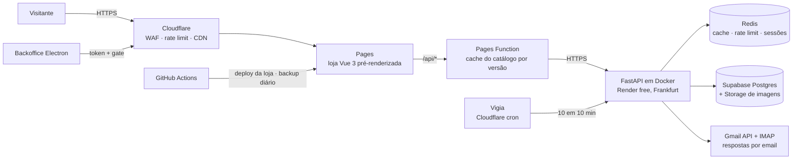

# Diomika — plataforma B2B de catálogo e orçamentos

> **Espelho público** do repositório privado de produção: o código é o mesmo; identificadores de infraestrutura foram substituídos, o histórico foi condensado e os workflows de deploy estão em [`ops/workflows/`](ops/workflows) só para leitura. Segredos nunca estiveram no código (GitHub Secrets e `.env` do servidor).

[](https://github.com/tomascms/diomika-platform/actions/workflows/ci.yml) [](https://github.com/tomascms/diomika-platform/actions/workflows/security-scan.yml)

**Em produção:** [www.diomika.com](https://www.diomika.com) · loja + API + backoffice desktop, construídos
e operados de ponta a ponta por uma pessoa, com **0 € de infraestrutura**.

> **EN —** Production B2B catalogue and quote-request platform for a Portuguese home-textiles
> supplier. Vue 3 storefront on Cloudflare Pages (edge-cached catalogue, prerendered SEO pages),
> FastAPI backend in Docker on Render's free plan behind Cloudflare, Supabase Postgres,
> and an Electron backoffice (catalogue, messages, quotes, printable labels). Built, secured, measured and run solo at zero hosting
> cost. Docs are in Portuguese; see *Destaques* below for the engineering highlights.

## O problema
Um fornecedor de têxteis para o lar vende só a lojas (pedido mínimo 500 € + IVA, sem preços
públicos). Precisava de: um catálogo online com modelos em várias cores e medidas (cada variante com EAN),
pedidos de orçamento sem conta de cliente, e uma ferramenta interna para gerir catálogo, mensagens
e pedidos — sem custos mensais de alojamento.

## Arquitectura


| Peça | Pasta | Tecnologia | Onde corre |
|---|---|---|---|
| Loja | [`frontend-web/`](frontend-web) | Vue 3, Vite, Pages Functions | Cloudflare Pages |
| API | [`backend-api/`](backend-api) | Python 3.12, FastAPI, Redis | Docker no Render (plano free), atrás da Cloudflare |
| Base de dados | [`db/`](db) | PostgreSQL (Supabase), RLS, migrações versionadas | Supabase Free (Irlanda) |
| Backoffice | [`backoffice-desktop/`](backoffice-desktop) | Electron, Vue 3 | PC do cliente (Windows e macOS) |
| Operação | [`deploy/`](deploy), [`.github/`](.github/workflows) | Bash, Python, GitHub Actions | Render + CI |

## Destaques (medidos em produção)

**Desempenho**
- LCP no telemóvel: **0,64 s** na página inicial e **1,0–1,7 s** numa página de produto nunca
  visitada (era 3,9 s) — *preload* da imagem principal no HTML pré-renderizado + detalhes
  pré-aquecidos em Redis no arranque e depois de cada alteração.
- CLS **0,000** em início, categoria e produto (era 0,9 e 0,15).
- Imagem da página inicial de **435 KB → 22 KB**: miniaturas WebP 480/960 px geradas no upload
  e `srcset` que escolhe pelo ecrã.
- Catálogo em cache no edge com chave por versão (invalidação imediata) e *stale-if-error*: se a
  API cair, a loja continua a mostrar o catálogo até 7 dias.
- TTFB p95 **< 200 ms** através da Cloudflare.

**Segurança**
- API atrás do proxy da Cloudflare (WAF e rate limit); estado persistente no Supabase com RLS sem políticas (só a chave de serviço).
- CSP estrita sem `unsafe-inline`/`unsafe-eval`, HSTS preload, COOP/CORP — verificadas no CI
  ([`verify_csp.py`](deploy/verify_csp.py)) depois de um incidente real em que a CSP partiu os formulários.
- Turnstile + rate limiting em três camadas (Cloudflare, Redis por IP/utilizador, concorrência do uvicorn).
- Sessões do backoffice com expiração absoluta e por inactividade, revogáveis, uma por utilizador.
- RLS na BD, guarda SSRF nas saídas HTTP, verificação de que nenhum segredo vai no bundle,
  gitleaks/Trivy/Bandit no CI, logs com segredos e emails mascarados.

**Fiabilidade e operação**
- Deploy da API sem corte: o Render só troca de versão quando `/health/live` responde; vigia de 10 em 10 min à API e à loja.
- Backup diário da BD (incluindo utilizadores do backoffice) no GitHub Actions, verificado com `pg_restore --list`; idempotência nos formulários
  (`Idempotency-Key`) e *outbox* para emails que falham.
- Logs JSON estruturados com `request_id`, Sentry, `/metrics` Prometheus protegido, UptimeRobot.
- Auditoria de requisitos não funcionais com correcções e medições:
  [`docs/conformidade-rnf.md`](docs/conformidade-rnf.md).

**Backoffice desktop**
- Actualizações automáticas com assinatura própria verificada antes de instalar
  ([`update-signature.cjs`](backoffice-desktop/electron/update-signature.cjs)), sem certificado pago.
- Etiquetas Brother (.lbx) desenhadas como uma só imagem 1-bit a 300 DPI com o tamanho exacto da área
  imprimível, com QR e EAN-13; validadas no motor de render da própria Brother (b-PAC) e com os códigos
  descodificados ([`etiquetaImagem.js`](backoffice-desktop/src/lib/etiquetaImagem.js)).
- Criação de modelos guiada: categoria, família e subcategoria escolhidas antes do formulário, que
  mostra só os campos que essa combinação exige (gerados a partir do esquema da API).

**Qualidade**
- 630 testes de backend (isolados: nunca tocam em produção), cobertura com mínimo no CI;
  testes de regressão para cada defeito corrigido (ex.: o event loop não pode bloquear durante
  um envio de formulário).
- Esquema de catálogo unificado e orientado a dados: uma família de produto nova é **uma entrada
  num dicionário** ([`docs/adicionar-familia.md`](docs/adicionar-familia.md)).

## O que este projecto demonstra
| Área | Onde ver |
|---|---|
| **Backend e APIs** — FastAPI assíncrono, RBAC, sessões revogáveis, idempotência, sagas/outbox | [`backend-api/`](backend-api), [`core/session_tokens.py`](backend-api/core/session_tokens.py), [`core/saga/`](backend-api/core/saga) |
| **Frontend e performance web** — Vue 3, pré-renderização SEO, Core Web Vitals medidos e corrigidos | [`frontend-web/`](frontend-web), [`scripts/prerender-seo.mjs`](frontend-web/scripts/prerender-seo.mjs), [`SoftImage.vue`](frontend-web/src/components/SoftImage.vue) |
| **Edge computing** — cache por versão, *stale-if-error*, CSP no edge | [`functions/api/[[path]].js`](frontend-web/functions/api/%5B%5Bpath%5D%5D.js), [`functions/_middleware.js`](frontend-web/functions/_middleware.js) |
| **Aplicação desktop** — Electron, proxy local, etiquetas Brother (.lbx) com QR e código de barras, Windows/macOS | [`backoffice-desktop/`](backoffice-desktop), [`src/lib/etiquetaLbx.js`](backoffice-desktop/src/lib/etiquetaLbx.js) |
| **Cloud e infraestrutura** — Render (API via API REST), Docker, Cloudflare WAF/Pages/Workers cron | [`deploy/render_setup.py`](deploy/render_setup.py), [`deploy/watchdog/`](deploy/watchdog) |
| **Segurança aplicacional** — CSP, rate limiting em camadas, SSRF guard, RLS, redacção de logs, verificações no CI | [`deploy/verify_*.py`](deploy/README.md#verificar-ci-e-pós-deploy), [`core/ssrf_guard.py`](backend-api/core/ssrf_guard.py) |
| **Dados** — modelo de catálogo unificado orientado a esquema, migrações versionadas, backups e restauro | [`db/`](db), [`models/catalog_attributes.py`](backend-api/models/catalog_attributes.py), [`db-backup.yml`](.github/workflows/db-backup.yml) |
| **SRE / operação** — deploy sem corte, vigia, métricas Prometheus, logs estruturados, runbook | [`deploy/watchdog/`](deploy/watchdog), [`core/metrics.py`](backend-api/core/metrics.py), [`docs/runbook.md`](docs/runbook.md) |
| **Engenharia de qualidade** — auditoria de requisitos não funcionais com medições e correcções | [`docs/conformidade-rnf.md`](docs/conformidade-rnf.md), [`docs/auditoria-backoffice.md`](docs/auditoria-backoffice.md) |
| **Produto e cliente** — documentação para o utilizador final | [`docs/guia-cliente.md`](docs/guia-cliente.md) |

## Decisões de engenharia
| Decisão | Porquê | Custo aceite |
|---|---|---|
| Render free + vigia que o mantém acordado | 0 €/mês, sem cartão; deploy a cada push | 1 só instância, 0,1 CPU, disco efémero (estado no Supabase) |
| Cache no edge com versão do catálogo | Visitantes servidos perto deles; a API em Frankfurt pesa ainda menos | Pedido extra de versão a cada 5 s por PoP |
| Miniaturas geradas no upload | Transformação de imagens da Supabase é paga | Backfill para imagens antigas |
| 1 worker uvicorn + `asyncio.to_thread` para I/O síncrono | Cabe em 1 GB de RAM | Débito limitado na origem (o edge absorve leituras) |
| Pré-renderização no build em vez de SSR | Páginas estáticas, sem servidor de render | Conteúdo visível montado em JS |
| Backoffice desktop em vez de web | Rotas de admin bloqueadas no WAF sem o cabeçalho secreto da app, além do token | Distribuição e actualização automática próprias |

## Estrutura
```
backend-api/        API FastAPI: routes/, core/ (auth, cache, sagas, segurança), models/, workers/, tests/
frontend-web/       Loja Vue 3: src/, functions/ (edge), scripts/prerender-seo.mjs
backoffice-desktop/ Electron + Vue 3: electron/ (processo principal, updater), src/
db/                 migrations/ (aplicadas, datadas), README
deploy/             publicar, verificar, operar — índice em deploy/README.md
docs/               runbook, guia do cliente, auditorias, entrega ao cliente
```

## Correr localmente
```bash
pip install -r requirements-dev.txt
cd backend-api && python -m pytest tests -q     # isolado por tests/conftest.py
cd frontend-web && npm ci && npm run dev
cd backoffice-desktop && npm ci && npm run dev
```
O `.env` da raiz é de **produção** (ver [`.env.example`](.env.example)); os testes e2e só correm com
`E2E_API_URL` definido.

## CI/CD
| Workflow | Quando | Faz |
|---|---|---|
| [`ci.yml`](.github/workflows/ci.yml) | PR e push | testes + cobertura mínima, Bandit, lint, builds, Trivy |
| [`security-scan.yml`](.github/workflows/security-scan.yml) | PR, push, semanal | gitleaks, `pip`/`npm audit`, Trivy da imagem |
| [`deploy-loja.yml`](ops/workflows/deploy-loja.yml) | push em `frontend-web/` | build, verificação de CSP e segredos, publicação, verificação live |
| [`db-backup.yml`](.github/workflows/db-backup.yml) | diário 03:30 UTC | `pg_dump` da BD, artefacto 14 dias (a API publica-se sozinha no Render a cada push na `main`) |
| [`uptime.yml`](ops/workflows/uptime.yml) | à mão | verificação da API e da loja (o UptimeRobot e o vigia fazem-na sempre) |
| [`backoffice-release.yml`](ops/workflows/backoffice-release.yml) | à mão | `.dmg` do Mac, artefacto privado de 1 dia (nunca publicado) |

## Documentação
- [Runbook](docs/runbook.md) — deploy, rollback, backups, chaves, incidentes
- [CHANGELOG](CHANGELOG.md)
- [Matriz de conformidade](docs/conformidade-rnf.md) · [Auditoria do backoffice](docs/auditoria-backoffice.md)
- [Guia do cliente (backoffice)](docs/guia-cliente.md) · [Adicionar família de produto](docs/adicionar-familia.md)
- [Base de dados](db/README.md) · [Scripts de operação](deploy/README.md)

Licença: proprietária, todos os direitos reservados — publicado para consulta (portefólio); o cliente tem licença de uso.
